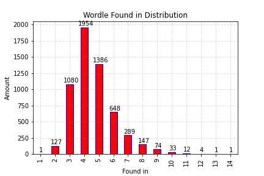
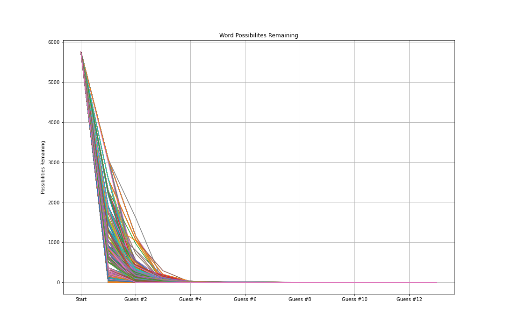
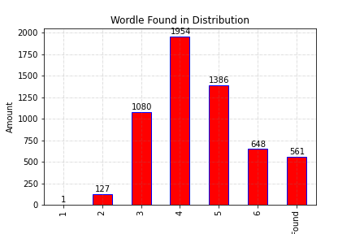
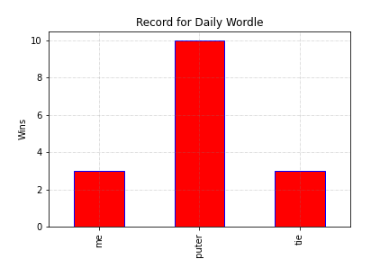

<div align="center">

# Wordle

**One of my first personal projects.** A statistical dive into Wordle strategy — built for fun in 2022, revisited in 2025.

[](https://www.python.org)
[](https://flask.palletsprojects.com)
[](https://jupyter.org)
[](LICENSE)

</div>

<br />

<table>
<tr>
<td width="50%"></td>
<td width="50%"></td>
</tr>
<tr>
<td width="50%"></td>
<td width="50%"></td>
</tr>
</table>

## History

Built in **2022**, not long after Wordle took off, out of curiosity about whether letter-frequency stats could out-guess intuition. Revisited briefly in **2025** to rerun the analysis with more data. It predates the habits — dependency pinning, tests, a structured layout — I'd reach for on something built today. This repo is cleaned of accumulated cruft (duplicate binaries, stale reruns, cache files) but deliberately not modernized: it's kept as a snapshot of early work, not a demonstration of current practice.

## How it works

- `all wordles.ipynb` — main analysis notebook: possibilities remaining per guess, letter/word distribution stats, generates the charts above and the interactive `complete_found_in_distribution.html` export.
- `Best Guess Individual.ipynb` — analysis of the best individual opening guesses.
- `wordle.py` — minimal Flask app that serves the results: `home.html` links to `letters.html`, which serves the generated distribution chart.

## What's here

- **Data** — `Wordle.csv`, `guesses.json`, `remaining.json` (cached inputs/outputs of the analysis), `5-letter-words` (candidate word list).
- **Charts** — `docs/screenshots/` holds the exported chart images; `complete_found_in_distribution.html` is the interactive Plotly version.
- **`Record.txt`** — a personal scoreboard (me vs. computer vs. tie) from playing against the model's suggestions.

## Getting started

```bash
pip install -r requirements.txt
python wordle.py
```

Then visit `http://localhost:5000`. To rerun the analysis itself, open the notebooks in Jupyter (or any notebook-capable editor).

## License

[MIT](LICENSE) © Jack Van Zeeland
